<div align="center">

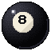

# VERTICAL BILLIARD

### One ball. One tower. No checkpoints.

A pixel-art **precision climbing game** where you are the cue ball.<br>
It takes from *Jump King*, *Fallosophy* and *Ballgame*, and it's chalked up for the pool hall.


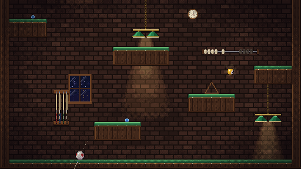

</div>

---

## About

Somewhere above the Back Room, past Lucky's Neon Bar and the Royal Club, there's a gold pocket on a table on the roof. You are a cue ball. You aim, you charge, you strike, and once you're in the air nothing can save a bad shot. Miss, and the climb hands you back to the felt you started from.

## Features

- **Jump King's commitment.** You charge a shot and release it, with no air control. The camera shows one screen at a time and glides quickly to the next as you cross an edge, so you never lose the ball. There are no checkpoints, and the game saves you wherever the ball comes to rest. Time, strokes and falls are tracked.
- **Billiard shot-making.** You aim in 5° notches and the cue pulls back as the shot charges. **English** shapes the landing: follow keeps you running forward and draw checks you up or rolls you back.
- **Fallosophy's pinball.** Big numbered bumper balls kick you away in their brass collars. Rubber cushions stay lively, and pockets swallow you and drop you far below through the ball return.
- **Ballgame's collection.** Twenty-four lost balls are hidden across the levels, six in each, and seven more are earned by finishing. Each one becomes a ball you can climb as, picked from the **Ball Rack**.
- **Balls that really roll.** Every ball is a pixel-art sphere drawn with spherical UV mapping, so numbers, stripes and the cue ball's red dots roll across the surface.
- **Four levels, both modes.** The Tower, The Long Rack, The Moon Shot and The Gale, picked from a small level select. Each opens once you've finished the one before it, in either mode. Normal and Hardcore share the levels and each keeps its own run for each level.
- **Things that move.** The Long Rack adds brass carriages that ride their rails sideways, up and down, or diagonally, and carry you with them, plus red-and-yellow spinning arms and spiked balls that fling you away.
- **Low gravity and wind.** The Moon Shot floats you across the moon and open space. The Gale's wind blows one way per stretch, like Jump King: a tailwind here, a headwind there, an updraft or a downdraft, gusting for a few seconds then dropping to calm. It pushes you while you fly, so you aim into it or wait for the lull. Hardcore's white ball is never blown. Props respond: socks, bunting and vanes follow the gust, lamps sway, asteroids drift when bumped.
- **Hardcore mode.** You play your normal ball with the same rules, plus a second, plain white ball that floats with no gravity. It starts floating just above you. Knock it up through the whole tower and sink it in the gold pocket. Each mode opens with a short goal pop-up when a new climb starts. Felt drag stops it wherever it runs out of speed, even in mid-air, and if it drops into a pocket it goes down the ball return. An arrow at the screen edge points to it when it's on another screen.
- **Pool-hall jazz.** Four synthesised loops, one per zone: slow Back Room blues, a Neon Bar shuffle, a Royal Club waltz and a moonlit summit theme. They crossfade as you climb.
- **A room that reacts.** Lamps and chandeliers swing on their chains, windows shatter and stay broken, neon shorts out, portraits hang crooked, beads slide along the score wire and chalk gets knocked off ledges. All of it is cosmetic: the ball's path never changes.
- **Three zones and a summit:** the Back Room, Lucky's Neon Bar, the Royal Club (fast felt) and the King's Table under the moon.
- **Training mode.** Practise any level you've opened, Geometry Dash style: rest on the felt and press **C** to plant a checkpoint flag, **R** to go straight back to the newest flag, **X** to pull it up and fall back on the one before. Flags wave, stream out in the wind, flutter as you roll past and glow while they're the one R returns to. Training has no lost balls, and nothing in it is saved, recorded or unlocked.
- **Plays on phones and tablets.** On a touchscreen, round brass buttons appear over the game: arrows to aim, spin and look on the left, a big cue button to strike on the right, pause at the top, and the flag buttons in Training. They're see-through, and fade almost away when the ball is behind one. They only show on touch devices, so they never get in the way on a computer.
- **Proven climbable.** A headless solver fires every shot from every resting spot using the real physics. It checks that the gold pocket can be reached and measures how forgiving each jump is.

## Screenshots

| | |
| --- | --- |
| 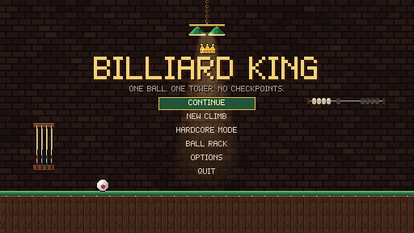 | 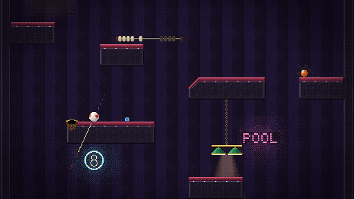 |
| *Title* | *Lucky's Neon Bar* |
| 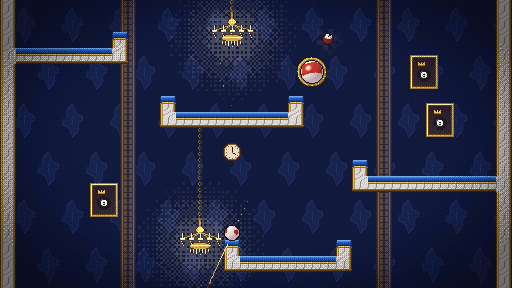 | 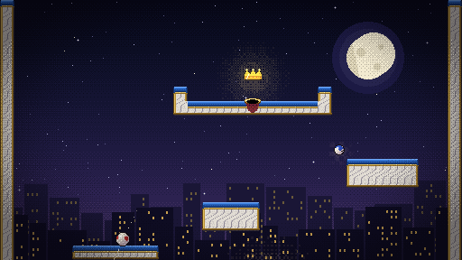 |
| *The Royal Club* | *The King's Table* |
| 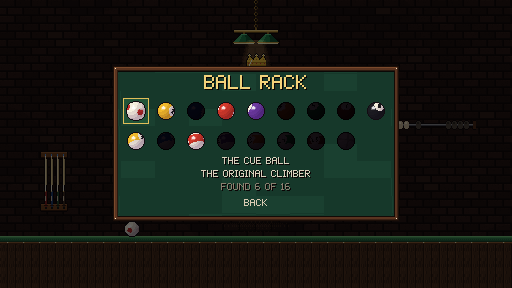 | 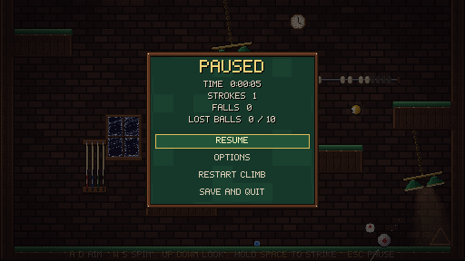 |
| *Ball Rack* | *Pause and run stats* |
| 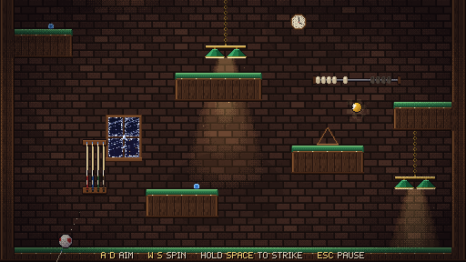 | 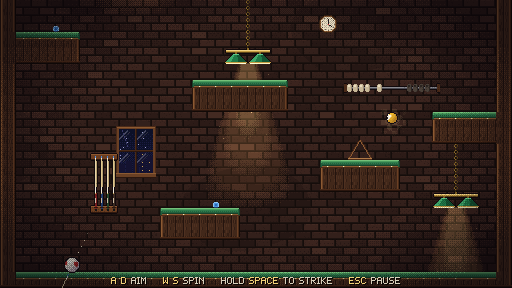 |
| *A window gives way* | *Controls hint on the bottom rail* |
| 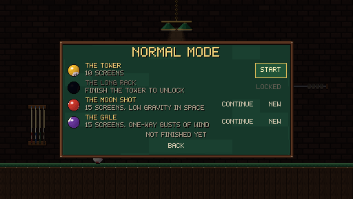 | 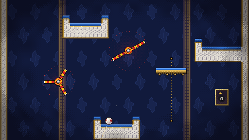 |
| *Level select* | *The Long Rack: spinning arms and a carriage* |
| 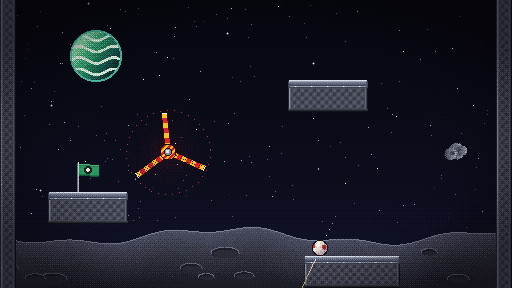 | 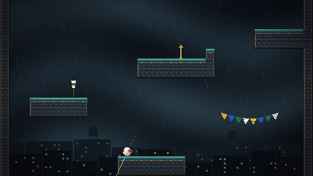 |
| *The Moon Shot: low gravity on the moon* | *The Gale: wind on the rooftops* |
| 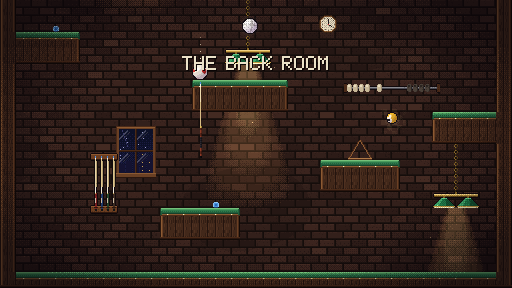 | 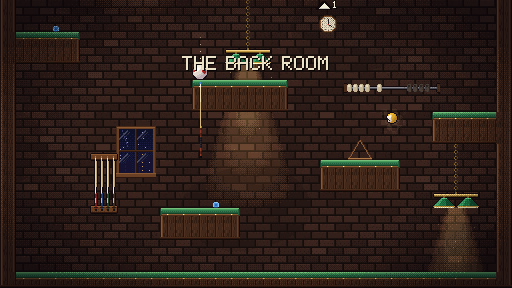 |
| *Hardcore: your ball and the floating white ball* | *The edge arrow points to it off screen* |
| 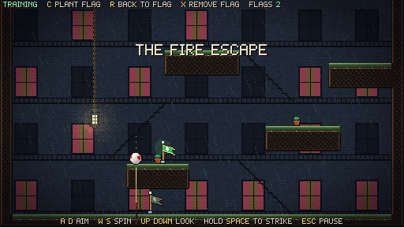 | 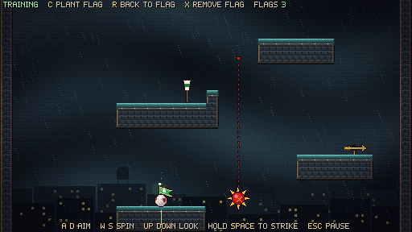 |
| *Training: the newest flag is lit, older ones fade* | *A flag streaming in a rooftop gust* |
| 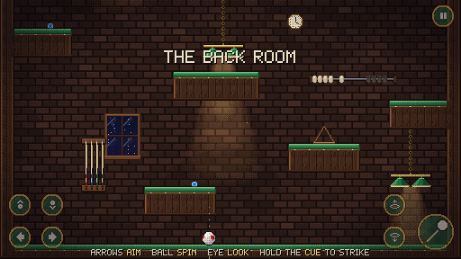 | |
| *Touch controls on a phone or tablet* | |

## Controls

| Action | Keyboard | Gamepad | Touch |
| --- | --- | --- | --- |
| Aim (5° notches, hold to sweep) | A / D or ← / → | D-pad / left stick | Arrow buttons, bottom left |
| English: follow / draw | W / S | D-pad / left stick | Ball buttons above the arrows |
| Look up / down (camera peek) | ↑ / ↓ (hold) | Right stick | Eye buttons, bottom right |
| Charge, release to strike | Space, Z or J (hold) | A | Cue button (hold) |
| Pause | Esc or P | Start | Pause button, top right |
| Training: plant a flag | C | Y | Flag + button, top right |
| Training: back to the newest flag (or the start) | R | X | Flag ↩ button |
| Training: remove the newest flag | X | LB | Flag × button |

A controls hint appears on the rail of the bottom table while the ball sits there. It hides as you climb and comes back if you fall all the way down, switching to gamepad prompts when you use a pad.

**Touchscreens.** The buttons appear only on a phone, tablet or touchscreen computer. In the default **Auto** setting a key or gamepad press hides them and a touch brings them back; **Options > Touch controls** can also force them **On** or **Off**. Menus work by tapping, a tap dismisses the goal pop-up and the ending, and holding a phone upright shows a reminder to turn it sideways. On touch devices the picture fills the screen instead of scaling by whole numbers.

You can only strike from flat felt; slopes make you slide. A full charge fires by itself. If you hold the charge button while you land, the charge starts on touchdown.

## Training mode

Pick **Training** on the title, then any level you've already opened (locked levels stay locked: Training can't open them). It works like Geometry Dash's practice mode, adapted to a game where falling, not dying, is what costs you:

- **C** plants a flag where the ball is resting. You can't plant mid-air or on a moving carriage. Planting on an existing flag makes it the newest again.
- **R** puts the ball back on the newest flag at once, so you can retry a jump as often as you like. With no flags it goes back to the start.
- **X** pulls up the newest flag, and R then goes back to the one before. Flags stack as deep as you like.
- The newest flag glows green. Older flags fade but stay up, marking your route.
- There are no lost balls. A training win shows its time, strokes and falls, but it records nothing, earns no balls and opens no levels. Training runs aren't saved; your Normal and Hardcore runs are never touched.
- The training keys stay on the top line the whole time. The full controls show whenever the ball rests, not only on the bottom floor.

## Level 2: The Long Rack


Twice the length of The Tower, across The Cellar, The Jukebox Floor, The Grand Salon and The Rooftop Final.

| New thing | What it does | How to spot it |
| --- | --- | --- |
| **Carriage** | Rides a rail sideways, up and down, or diagonally. It carries the ball, and shots keep its momentum. | Felt deck on a brass frame with wheels, on a dotted brass rail |
| **Spinning arm** | Touch an arm and you're flung away. | Red and yellow stripes, a pulsing red glow, and a dotted ring showing its reach |
| **Spike rail** | A spiked ball slides along a rail. Touch it and you're flung away. | Red ball with yellow spikes on a dotted red rail |

Only traps use red and yellow hazard colours, so they can't be mistaken for decoration.

## Level 3: The Moon Shot

15 screens from The Observatory, across The Sea of Felt and The Launch Deck, into Open Space. On the moon gravity drops to 45%, in open space to 35%, so a full shot sails more than a screen. Asteroids drift when bumped and float home, satellites spin up when struck, flags ripple.

## Level 4: The Gale

15 screens from The Fire Escape up The Rooftops, with a calm stretch through The Bell Tower. Each windy stretch blows one way, right, left, up or down, for about three seconds at a time with calm in between. Gusts only push your ball in the air. Rain falls on the Fire Escape and the Rooftops and bends with each gust (slanting in a crosswind, slowed by an updraft, driven down by a downdraft), pale streaks show where the wind is going, and wind socks, bunting and weather vanes follow it.

## The tower

| Screens | Zone | What's new |
| --- | --- | --- |
| 0–2 | **The Back Room** | Walnut tables under green billiard lamps, slopes, the first pocket, a cushion cup |
| 3–5 | **Lucky's Neon Bar** | Bumper balls, a pocket waiting on an edge, long traverses |
| 6–8 | **The Royal Club** | Fast blue felt, lipped trays, rubber cushion ramps, chandeliers |
| 9 | **The King's Table** | The rooftop and the gold pocket |

## The Ball Rack

| Ball | How to get it |
| --- | --- |
| Cue ball | Always yours |
| 1–6 | Lost somewhere in The Tower; touch one to collect it |
| 7–10, Chalk, Neon | Lost somewhere in The Long Rack |
| Checker, Tournament, Marble, Ember, Ocean, Night | Lost somewhere in The Moon Shot |
| Gold, Moon, Comet, Aurora, Thunder, Copper | Lost somewhere in The Gale |
| 11 | Finish the climb |
| 12 | Finish in under 400 strokes |
| 13 | Finish in under 30 minutes |
| 14 | Finish with 10 falls or fewer |
| 15 | Finish The Tower holding its six lost balls |
| White ball | Finish Hardcore mode |
| The rainbow ball | Finish The Long Rack on Hardcore. It cycles through the colours as it rolls, and glows |

## Getting started

1. Install **Godot 4.7** (the standard build; the project uses the Compatibility renderer).
2. Open `project.godot` and press **F5**.

The game renders at 512×288 and scales by whole numbers (1536×864 window by default). Fullscreen, volumes, screen shake and touch controls are under **Options**.

**Web build:** export with the **Web** preset (single-threaded, so it runs on itch.io without special headers). Web audio uses Godot's **Stream** playback (`audio/general/default_playback_type.web`), the same mixer as the desktop game. The default Sample mode played nothing in real Chrome, on itch.io or anywhere else. Browsers only allow sound after the first click or key press inside the game, so it is silent until then. For itch.io, export with **Export Project** (release, not debug: debug builds show the test unlock button), zip the folder's contents and upload. Opening `index.html` straight from disk doesn't work; serve the folder over HTTP (for example `python -m http.server` in it) or upload it to itch.io.

## Saves & settings

**Options** has a **Reset all progress** button (press it twice) that wipes every run, the Ball Rack and all records, but keeps your settings. When running from the Godot editor or a debug export, Options also shows **Test: unlock everything**, which opens every level and fills the Ball Rack; release exports hide it.

Saves live in `user://vertical_billiard.cfg` (on Windows, `%APPDATA%\Godot\app_userdata\Vertical Billiard\`). A save from when the game was called Billiard King is copied across on first launch. The file holds settings, the run in progress (ball position, aim, spin, time, strokes, falls, zones seen) and the Ball Rack. Tests use separate `test_*.cfg` profiles and never touch your save.

## Project structure

```
assets/        textures (exported PNGs), source/ (.aseprite), fonts/, audio/ (+ music/)
levels/        tower.txt, tower2-4.txt: each climb as ASCII screens
resources/     tiles.tres (generated), ui_theme.tres
scenes/        ui/title.tscn, world/game.tscn, world/tower*.tscn (generated)
scripts/core   ball_sim.gd (physics), collision_world.gd (tiles, bumpers, pockets)
scripts/world  player_ball, ball_visual, cue_stick, tower, game, bumper, pocket, lost_ball
scripts/world (movers)  moving_platform, trap_spinner, trap_spike, rail_line, weather_layer, checkpoint_flag
scripts/world/props  reactive decor (swing, window, neon, tilt, rattle, beads, knock)
scripts/ui     title, pause, options, ball rack, ending, ui_kit, touch_controls
scripts/autoload  save_data.gd, sfx.gd
shaders/       ball.gdshader (rolling-ball sphere mapping), vignette.gdshader
tools/         art_*.lua (Aseprite), build_tower.gd, build_sfx.gd, *.ps1 helpers
tests/         gameplay_test, menu_test, props_test, hardcore_test, level2_test, conditions_test, training_test, touch_test, route_solver, capture*
docs/          DESIGN.md, VALIDATION.md, screenshots/
```

## Content pipeline

| Task | Command |
| --- | --- |
| Rebuild all pixel art (Aseprite Lua) | `powershell -File tools/build_art.ps1` (add `-Preview` for 4× previews) |
| Rebuild the tower after editing `levels/tower.txt` | `powershell -File tools/godot.ps1 --headless --script tools/build_tower.gd` |
| Re-synthesise the sound effects | `powershell -File tools/godot.ps1 --headless --script tools/build_sfx.gd` |
| Recompose the music | `powershell -File tools/godot.ps1 --headless --script tools/build_music.gd` |
| Run every test (with the Tower's climbability solver) | `powershell -File tools/run_tests.ps1` |
| Prove another level climbable (level 2 takes about 20 minutes) | `powershell -File tools/godot.ps1 --headless --script tests/route_solver.gd -- --level=2` |
| Retake screenshots | `powershell -File tools/godot.ps1 res://tests/capture.tscn -- --save-profile=capture` |

The legend for the level map is at the top of `tools/build_tower.gd`. After any level edit, run the solver: it fails if the gold pocket can't be reached or if a required stroke has fewer than 5 working shots.

Tuning values and how the rolling ball is rendered are in [docs/DESIGN.md](docs/DESIGN.md).

## Credits

- **Game, code, pixel art, synthesised audio and music:** Floor 38 Studio. Art is authored in Aseprite via `tools/art_*.lua`, sounds are designed in `tools/build_sfx.gd`.
- **UI blips, win jingle and summit wind:** [Ninja Adventure Asset Pack](https://pixel-boy.itch.io/ninja-adventure-asset-pack) by Pixel-boy & AAA (CC0).
- **Inspired by** *Jump King* (Nexile), *Fallosophy* (Reliable Plumbing Services) and *Ballgame* (Human Computer).

## License

Code and original art © Floor 38 Studio. The Ninja Adventure sounds keep their CC0 licence (see `assets/audio/NINJA_ADVENTURE_LICENSE.txt`).
